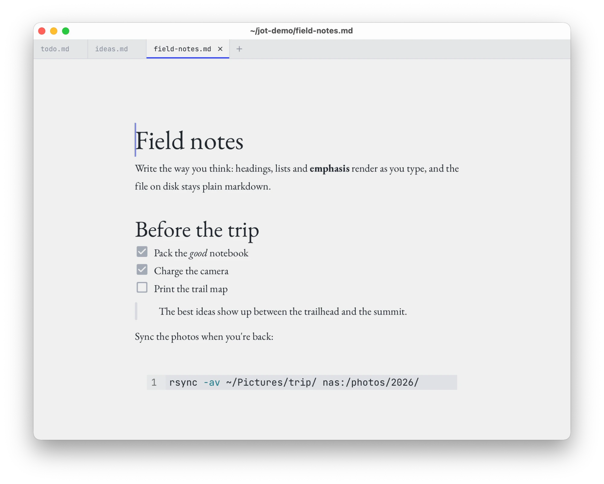

<div align="center">

# jot

**A fast, minimal markdown editor. Type `jot notes.md` and start writing.**

<picture>
  <source media="(prefers-color-scheme: dark)" srcset="demo-dark.png">
  
</picture>

[](https://github.com/benshanahan1/jot/releases)
[](https://github.com/benshanahan1/jot/actions)

[Download](https://github.com/benshanahan1/jot/releases/latest) | [Report a bug](https://github.com/benshanahan1/jot/issues) | [Request a feature](https://github.com/benshanahan1/jot/issues)

</div>

---

jot does one thing: it opens a markdown file, lets you write, and saves it. No projects, no sidebars, nothing to set up.

## Features

**Open files from anywhere**
- `jot notes.md` from the terminal. The file doesn't have to exist yet.
- Set jot as the default app for `.md` files and double-click them in Finder.
- Every file opens as a tab in the same window, even when jot is already running.

**Edit markdown as it will look**
- Headings, lists, task lists, quotes, links, and tables render as you type.
- Code blocks are syntax highlighted, with a language picker.
- Type `/` for a menu of blocks to insert.
- Files are saved as plain markdown. YAML or TOML front matter is kept exactly as it was.

**Don't lose work**
- jot asks before closing a tab or quitting with unsaved changes.
- Rename a file by double-clicking its tab. jot won't overwrite another file to do it.
- A small square on the tab, and `*` in the title bar, mark unsaved files.

**Keyboard first**
- Every action has a shortcut, shown next to it in the menus.
- `Cmd+W` closes the tab, and closes the app when it's the last one.

**Make it yours**
- Light, dark, or follow the system.
- Serif ([EB Garamond](https://fonts.google.com/specimen/EB+Garamond)), sans, or mono ([Inconsolata](https://fonts.google.com/specimen/Inconsolata)) for your writing. The serif and mono fonts are bundled, so they look the same on every machine.
- A comfortable reading width, or the full window.
- Zoom the text in and out.

Runs on macOS, Windows, and Linux.

## Install

Download the latest release for your platform:

- **macOS**: the `.dmg`. jot isn't notarized yet, so the first time you open it, right-click the app and choose **Open**.
- **Windows**: the `.msi` installer.
- **Linux**: the `.deb` or `.AppImage`.

[**Get the latest release**](https://github.com/benshanahan1/jot/releases/latest)

### The `jot` command

macOS already has a `/usr/bin/jot` (it prints sequential numbers), so install a wrapper that takes priority:

```bash
./scripts/install-cli.sh
```

This puts a `jot` command in `~/.local/bin` (change it with `--bin-dir`) that opens files in the installed app. It also replaces any wrapper from an earlier install and teaches zsh to complete file names after `jot`. Make sure `~/.local/bin` comes before `/usr/bin` on your `PATH`; the script warns you if it doesn't.

```bash
jot notes.md          # open a file, or start a new one
jot *.md              # open several, each in its own tab
```

To remove the command and the completion override:

```bash
./scripts/install-cli.sh --uninstall
```

To remove the app itself, move `jot.app` to the Trash.

### Make jot the default for Markdown files

On macOS, select any `.md` file in Finder, press `Cmd+I`, choose jot under **Open with**, and click **Change All…**.

## Keyboard shortcuts

On Windows and Linux, use `Ctrl` for `Cmd` and `Alt` for `Option`.

| Action | Shortcut |
|--------|----------|
| New tab | `Cmd+N` |
| Open | `Cmd+O` |
| Save / Save As | `Cmd+S` / `Cmd+Shift+S` |
| Rename | `Cmd+Shift+R` (or double-click the tab) |
| Close tab / window | `Cmd+W` / `Cmd+Shift+W` |
| Next / previous tab | `Cmd+Shift+]` / `Cmd+Shift+[` (or `Ctrl+Tab` / `Ctrl+Shift+Tab`) |
| Go to tab 1–8 / last tab | `Cmd+1`…`Cmd+8` / `Cmd+9` |
| Theme: system / light / dark | `Cmd+Option+1` / `2` / `3` |
| Font: serif / sans / mono | `Cmd+Option+4` / `5` / `6` |
| Wide layout | `Cmd+\` |
| Zoom in / out / reset | `Cmd+=` / `Cmd+-` / `Cmd+0` |

## Development

You'll need [Node.js](https://nodejs.org/) 20 or later and [Rust](https://rustup.rs/). [Bun](https://bun.sh/) is optional; the Tauri build runs it through `npx` if it isn't installed.

```bash
git clone https://github.com/benshanahan1/jot.git
cd jot
npm install

make dev      # run the app with hot reload
make test     # unit tests
make lint     # type-check
make build    # build the release app into src-tauri/target/release/bundle
```

Built with [Tauri](https://tauri.app/), React, TypeScript, and [Milkdown](https://milkdown.dev/).
