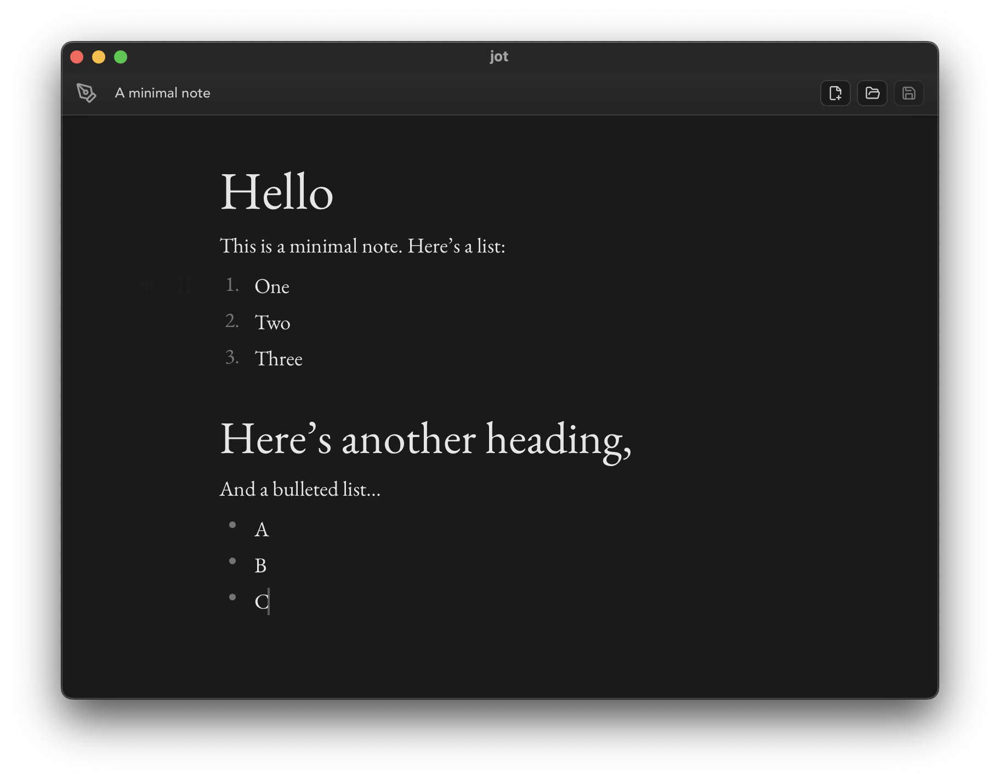

<div align="center">

# jot

**A minimalist markdown editor for macOS, Windows, and Linux**



Clean, distraction-free writing with live markdown rendering

[](https://github.com/benshanahan1/jot/releases)
[](https://github.com/benshanahan1/jot/actions)

[Download](https://github.com/benshanahan1/jot/releases) · [Report Bug](https://github.com/benshanahan1/jot/issues) · [Request Feature](https://github.com/benshanahan1/jot/issues)

</div>

---

## Features

- Opens instantly from the terminal (`jot notes.md`) or Finder
- Tabs, with every open file in one window
- Live markdown rendering, with front matter left untouched
- Serif, sans, and mono fonts (serif and mono are bundled, so they work offline)
- Light, dark, and system themes
- A keyboard shortcut for everything, shown in the menus
- Cross-platform (macOS, Windows, Linux)

## Installation

Download the latest release for your platform:

- **macOS**: Download the `.dmg` file
- **Linux**: Download the `.deb` or `.AppImage` file
- **Windows**: Download the `.msi` installer

[**→ Get the latest release**](https://github.com/benshanahan1/jot/releases/latest)

## Development

### Prerequisites

- [Node.js](https://nodejs.org/) (v20 or later)
- [Rust](https://rustup.rs/)
- [Bun](https://bun.sh/) (optional, for faster builds)

### Setup

```bash
# Clone the repository
git clone https://github.com/benshanahan1/jot.git
cd jot

# Install dependencies
npm install

# Run in development mode
npm run tauri dev

# Build for production
npm run tauri build
```

### Tech Stack

- **Frontend**: React, TypeScript, Vite
- **Backend**: Tauri (Rust)
- **Editor**: Milkdown (Markdown rendering)
- **Testing**: Vitest

## Keyboard Shortcuts

Every menu item shows its shortcut. On Windows and Linux, use `Ctrl` for `Cmd` and `Alt` for `Option`.

| Action | Shortcut |
|--------|----------|
| New tab | `Cmd+N` |
| Open | `Cmd+O` |
| Save / Save As | `Cmd+S` / `Cmd+Shift+S` |
| Rename | `Cmd+Shift+R` (or double-click the tab) |
| Close tab / window | `Cmd+W` / `Cmd+Shift+W` |
| Next / previous tab | `Cmd+Shift+]` / `Cmd+Shift+[` (or `Ctrl+Tab` / `Ctrl+Shift+Tab`) |
| Go to tab 1–8 / last tab | `Cmd+1`…`Cmd+8` / `Cmd+9` |
| Theme: system / light / dark | `Cmd+Option+1` / `2` / `3` |
| Font: serif / sans / mono | `Cmd+Option+4` / `5` / `6` |
| Wide layout | `Cmd+\` |
| Zoom in / out / reset | `Cmd+=` / `Cmd+-` / `Cmd+0` |

## Command Line

Open a file from your terminal (it doesn't need to exist yet):

```bash
jot notes.md
```

macOS ships its own `/usr/bin/jot`, so install a wrapper that takes priority:

```bash
./scripts/install-cli.sh
```

This puts a `jot` command in `~/.local/bin` (override with `--bin-dir`), replaces any wrapper from an earlier install, and adds a zsh completion override so `jot <TAB>` completes file names. Make sure `~/.local/bin` comes before `/usr/bin` on your `PATH`; the script warns you if it doesn't.

If jot is already running, files open as new tabs in its window.

To remove the command and the completion override:

```bash
./scripts/install-cli.sh --uninstall
```

To remove the app itself, move `jot.app` to the Trash.

### Default app for Markdown files

To open `.md` files in jot when you double-click them on macOS, select any `.md` file in Finder, press `Cmd+I`, choose jot under **Open with**, and click **Change All…**.

## Acknowledgments

- Built with [Tauri](https://tauri.app/)
- Markdown editing powered by [Milkdown](https://milkdown.dev/)
